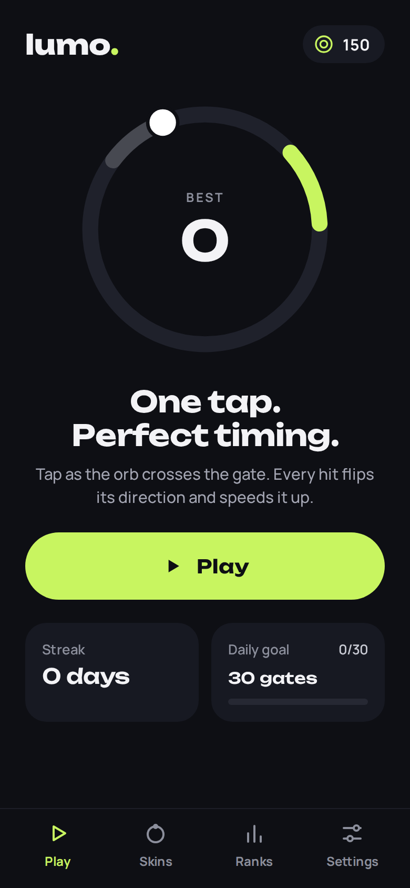
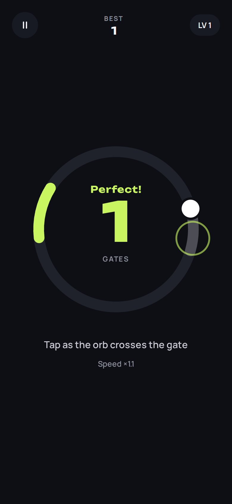
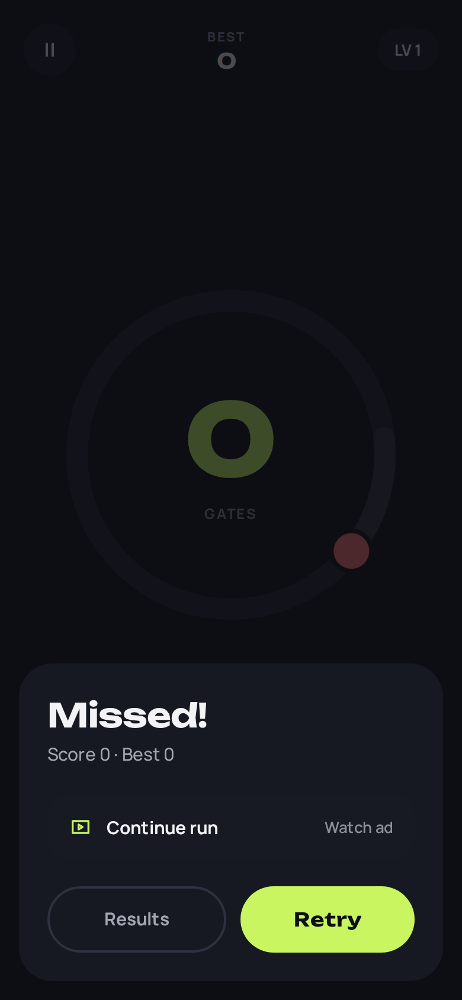
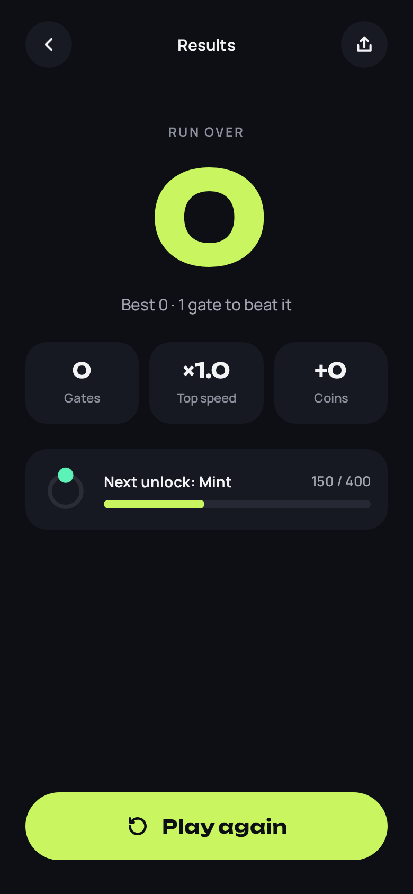
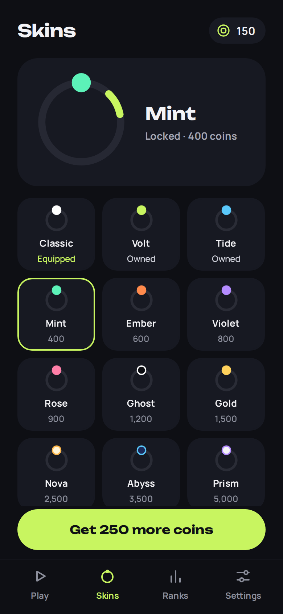
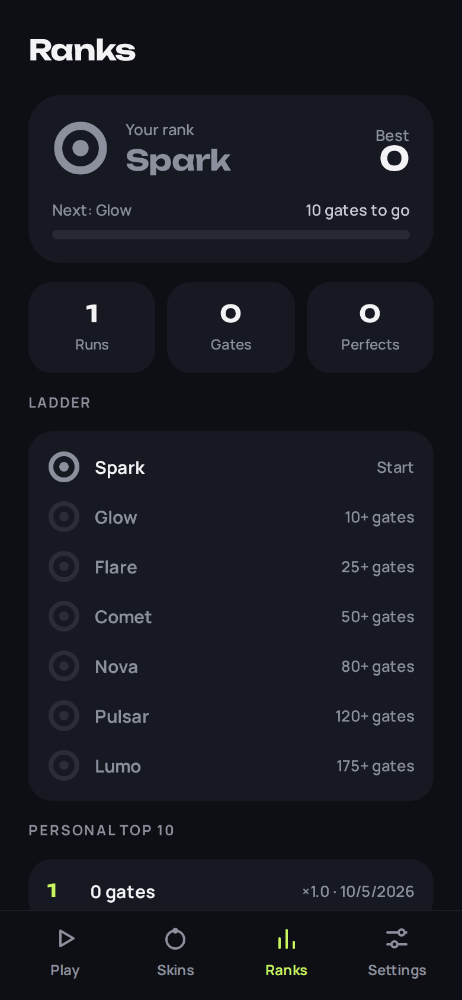
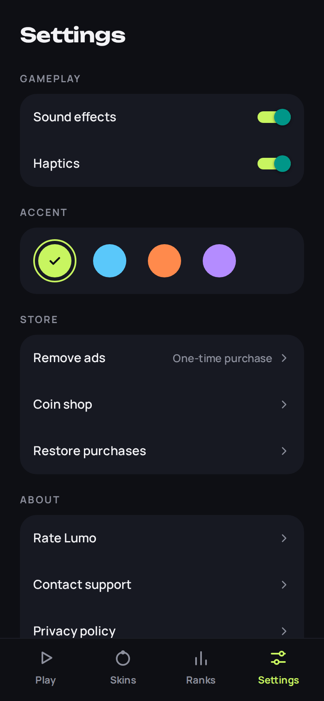
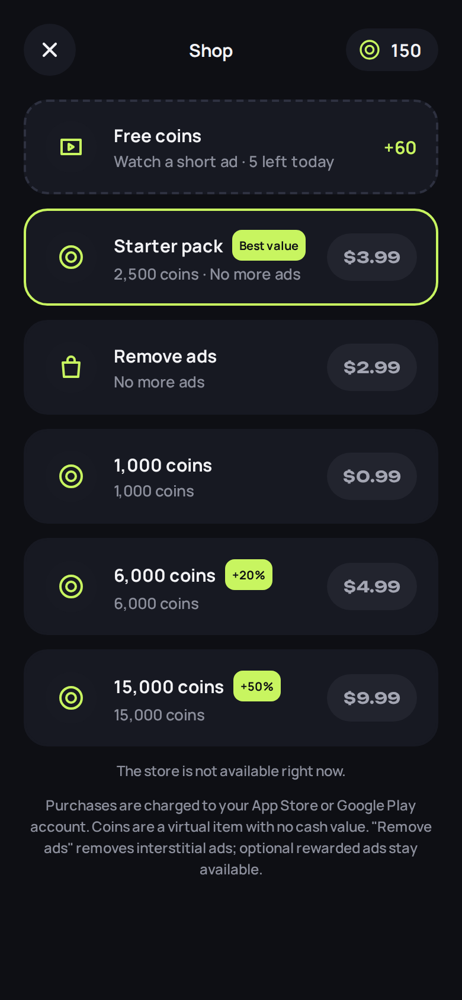

# Lumo: One-Tap Orbit Game

An orb circles a ring. Tap when it passes through the glowing gate. Each hit flips its direction, speeds it up and shrinks the gate. Miss, or let it slip past, and the run ends.

Built with **Expo SDK 57 / React Native 0.86** (new architecture) from one TypeScript codebase for **Android and iOS**. It's a 1:1 implementation of the _One-Tap Game App_ design canvas: dark ground, lime accent, Unbounded + Manrope.

## Screenshots

<p>       </p>

## Features

- **60/120 fps gameplay on the UI thread.** The physics step (sub-stepped, so the orb can't skip past a gate) and tap resolution run as Reanimated worklets. Rendering is GPU-accelerated with Skia. React doesn't re-render during play.
- **Taps register on touch-down** for near-zero input latency, with haptics and synthesized original SFX.
- **Screens:** Home (best, streak, daily goal), Gameplay (pause, levels, speed, Missed! sheet), Results (stats, next unlock, continue / double coins), Skins shop (12 orbs, coin unlocks), Ranks (7-tier ladder, personal top 10, lifetime stats), Settings (sound, haptics, accent theme, store, privacy), Coin Shop.
- **Monetization:** AdMob rewarded and interstitial ads with consent (UMP) and ATT, plus RevenueCat IAP (Remove Ads, Starter Pack, coin packs). See [`docs/MONETIZATION.md`](docs/MONETIZATION.md).
- **Production details:** MMKV persistence, crash-safe error boundary, idempotent purchase grants, app pauses when backgrounded, Android back handling, accessibility labels, privacy manifest, no unused permissions, release minification.

## Project layout

```
src/
  app/            Expo Router screens: (tabs)/index|skins|ranks|settings, play, results, shop
  game/           engine.ts (pure worklet engine), useGameEngine.ts, constants, skins, ranks
  components/     GameCanvas (Skia), Buttons, UI kit, Icon, AppText
  state/          zustand stores persisted to MMKV; progressLogic.ts holds the pure rules
  services/       ads, purchases, feedback (sound/haptics), review, config
  theme/          design tokens from the canvas
__tests__/        engine + economy unit tests
scripts/          generate-sounds.mjs, generate-icons.mjs
docs/             MONETIZATION, STORE_RELEASE, PRIVACY_POLICY
```

## Getting started

```bash
npm install
cp .env.example .env.local      # optional locally; test ads are used automatically in dev
npx expo prebuild               # or: eas build --profile development
npm run android                 # or: npm run ios (needs Xcode)
```

> The app uses native modules (Skia, MMKV, AdMob, RevenueCat), so it needs a **development build**. It won't run in Expo Go.

## Quality gates

```bash
npm run typecheck && npm run lint && npm test
```

CI (`.github/workflows/ci.yml`) runs the same three checks on every PR.

## Tuning

All gameplay and economy numbers live in `src/game/constants.ts` (speed, gate size, tolerances, coins). Ad pacing and products live in `src/services/config.ts`, and skins and prices in `src/game/skins.ts`.

## Releasing

Follow [`docs/STORE_RELEASE.md`](docs/STORE_RELEASE.md). In short: `eas init`, set the env vars, `npm run build:prod`, `npm run submit:prod`.
