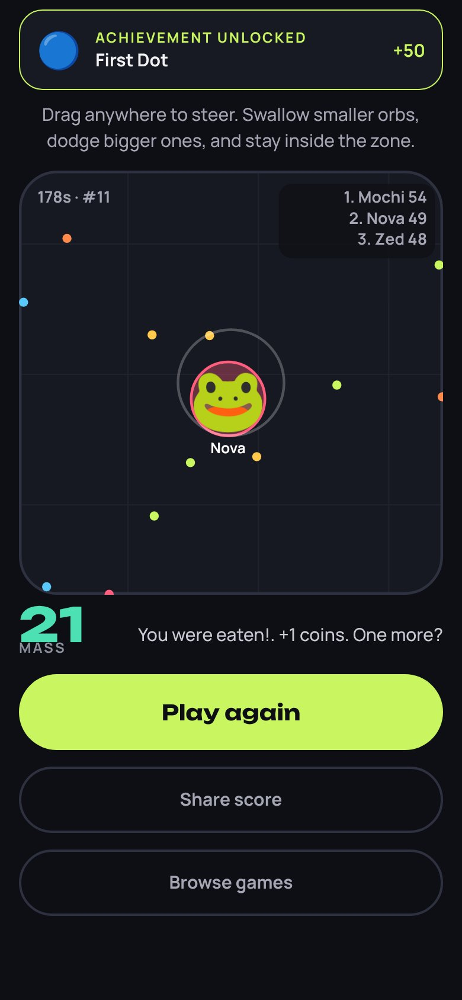
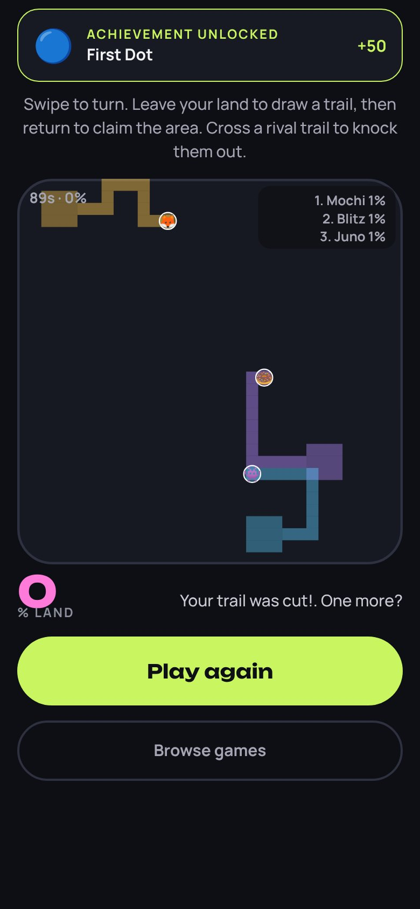
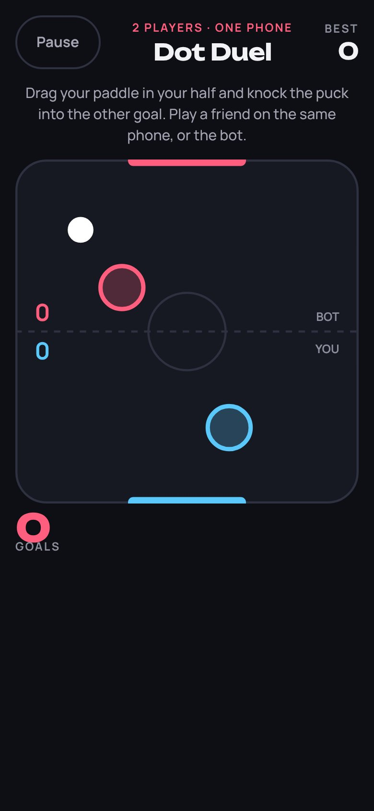
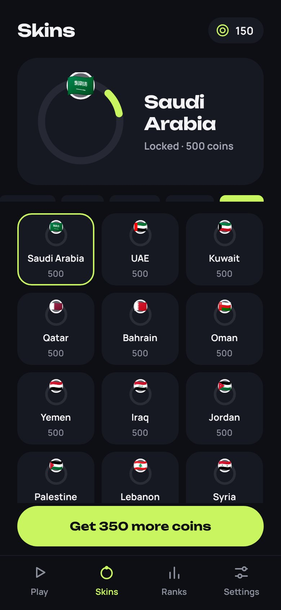
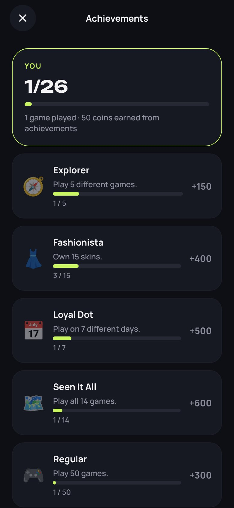
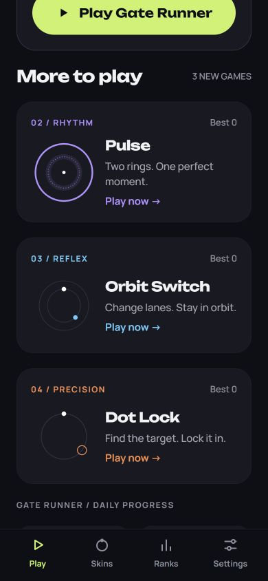
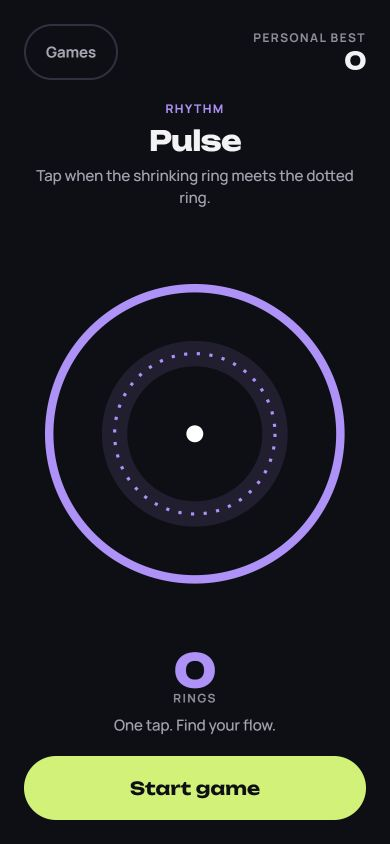
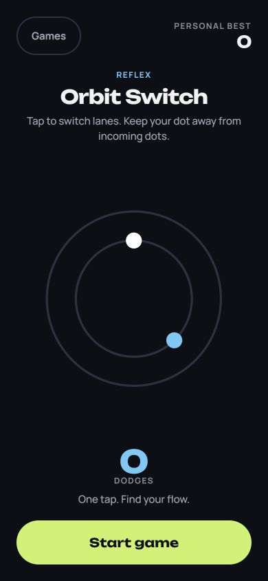
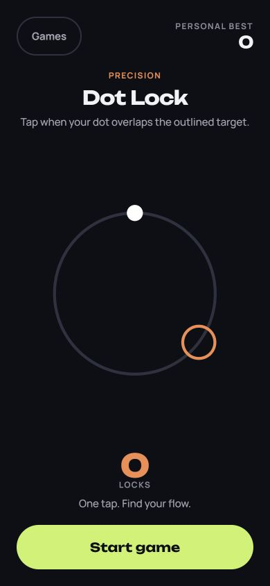

# Lumo: The Circle Collection

Four circle games, one tap: Dot Runner (the original), Dot Pulse, Dot Switch, and Dot Lock. Choose a game from the library and build a separate personal best in each. See [the collection guide](docs/CIRCLE_COLLECTION.md) for controls and screenshots.

**Move & Play: 10 more Dot games.** Dot Arena (agar-style battle), Dot Paint (territory battle), Dot Duel (2 players on one phone), Dot Drift, Dot Jump, Dot Sort, Dot Chain, Dot Link, Dot Maze and Dot Stack. Also included: 94 skins (characters, monsters and country flags), 26 achievements, and a dot name for battle leaderboards. See [the Move & Play guide](docs/MOVE_AND_PLAY.md) and the [online multiplayer design](docs/online/README.md).

<p>    </p>

Built with **Expo SDK 57 / React Native 0.86** (new architecture) from one TypeScript codebase for **Android and iOS**. It's a 1:1 implementation of the _One-Tap Game App_ design canvas: dark ground, lime accent, Unbounded + Manrope.

## Circle collection

<p>   </p>

## Original game screenshots

<p>       </p>

## Features

- **Gate Runner: 60/120 fps gameplay on the UI thread.** The physics step (sub-stepped, so the orb can't skip past a gate) and tap resolution run as Reanimated worklets. Rendering is GPU-accelerated with Skia. React doesn't re-render during play.
- **Gate Runner taps register on touch-down** for near-zero input latency, with haptics and synthesized original SFX.
- **Circle arcade:** Three additional SVG games with frame-based timing, persistent personal bests, pause/resume, instant retries, and equipped orb skins. Gate Runner retains its existing coins, ranks, and daily goals.
- **Screens:** Game library (four games, bests, Gate Runner streak and daily goal), Gameplay (pause, levels, speed, Missed! sheet), Results (stats, next unlock, continue / double coins), Skins shop (12 orbs, coin unlocks), Ranks (7-tier ladder, personal top 10, lifetime stats), Settings (sound, haptics, accent theme, store, privacy), Coin Shop.
- **Monetization:** AdMob rewarded and interstitial ads with consent (UMP) and ATT, plus RevenueCat IAP (Remove Ads, Starter Pack, coin packs). See [`docs/MONETIZATION.md`](docs/MONETIZATION.md).
- **Production details:** MMKV persistence, crash-safe error boundary, idempotent purchase grants, app pauses when backgrounded, Android back handling, accessibility labels, privacy manifest, no unused permissions, release minification.

## Project layout

```
src/
  app/            Expo Router screens: (tabs)/index|skins|ranks|settings, play, results, shop
  game/           engine.ts (pure worklet engine), useGameEngine.ts, constants, skins, ranks
  components/     GameCanvas (Skia), Buttons, UI kit, Icon, AppText
  state/          zustand stores persisted to MMKV; progressLogic.ts holds the pure rules
  services/       ads, purchases, feedback (sound/haptics), review, config
  theme/          design tokens from the canvas
__tests__/        engine + economy unit tests
scripts/          generate-sounds.mjs, generate-icons.mjs
docs/             MONETIZATION, STORE_RELEASE, PRIVACY_POLICY
```

## Getting started

```bash
npm install
cp .env.example .env.local      # optional locally; test ads are used automatically in dev
npx expo prebuild               # or: eas build --profile development
npm run android                 # or: npm run ios (needs Xcode)
```

> The app uses native modules (Skia, MMKV, AdMob, RevenueCat), so it needs a **development build**. It won't run in Expo Go.

## Quality gates

```bash
npm run typecheck && npm run lint && npm test
```

CI (`.github/workflows/ci.yml`) runs the same three checks on every PR.

## Tuning

All gameplay and economy numbers live in `src/game/constants.ts` (speed, gate size, tolerances, coins). Ad pacing and products live in `src/services/config.ts`, and skins and prices in `src/game/skins.ts`.

## Releasing

Follow [`docs/STORE_RELEASE.md`](docs/STORE_RELEASE.md). In short: `eas init`, set the env vars, `npm run build:prod`, `npm run submit:prod`.
