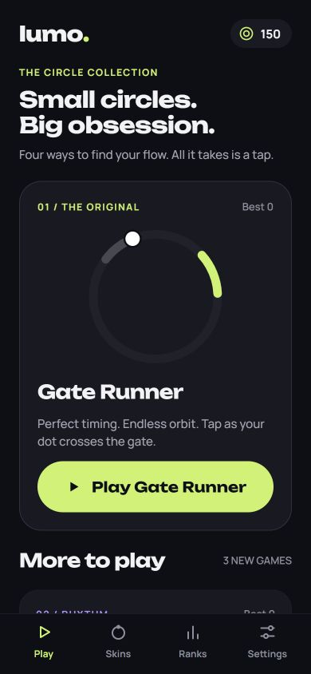

# The Circle Collection

Lumo opens to an 11-game library: these four circle games plus seven Move & Play games. Dot Runner is the original game and stays first, with its existing scores, coins, ranks, daily goal, and results flow.

| Game       | One-tap action                                            | Score          |
| ---------- | --------------------------------------------------------- | -------------- |
| Dot Runner | Tap as your orb crosses the gate                          | Gates cleared  |
| Dot Pulse  | Tap when the shrinking ring enters the dotted target band | Rings matched  |
| Dot Switch | Switch between two circular lanes to avoid incoming dots  | Dots dodged    |
| Dot Lock   | Tap when your orbiting dot overlaps the outlined target   | Targets locked |

The three new games have independent persistent personal bests. They use the equipped orb skin, sound and haptic settings. Their scores do not count toward Dot Runner ranks, coins, or daily gates. Difficulty increases with score and has a cap. There are no new dependencies or native configuration changes.

## Screenshots

Captured from the running Expo web preview at a 390 × 844 phone viewport. These are browser captures, not native-device screenshots. The original native screenshots remain in `screenshots/`.

 

  

## Implementation

- `src/game/arcade.ts`: game catalog and pure timing, collision, and scoring rules.
- `src/app/arcade.tsx`: shared game screen, frame loop, pause/resume, retry, and route validation.
- `src/components/ArcadeArt.tsx`: SVG artwork used in the library and gameplay.
- `src/state/arcade.ts`: separate MMKV-backed best scores, saved as each point is earned.

The new games render SVG on JavaScript animation frames. Dot Runner retains its existing UI-thread/Skia engine. Backgrounding, leaving the route, or a frame interruption longer than 250 ms pauses the new games. Android Back pauses a running game before allowing navigation away. The game field and the large action button both accept taps. Short screens scroll so controls remain reachable.

## Validation

- TypeScript and ESLint pass.
- 48 tests pass, including timing boundaries, early/missed taps, collisions, pause/resume, 100-round difficulty progression, independent best scores, and persistence/rehydration.
- Production web export and Android/iOS Hermes bundle exports pass.
- Browser smoke checks cover the library, all three games, start, pause, resume, miss, retry, navigation, and saved best after reload. Layout inspected at 390 × 844 and 320 × 568.
- Physical Android/iOS device gameplay and native frame-rate profiling remain release checks.
