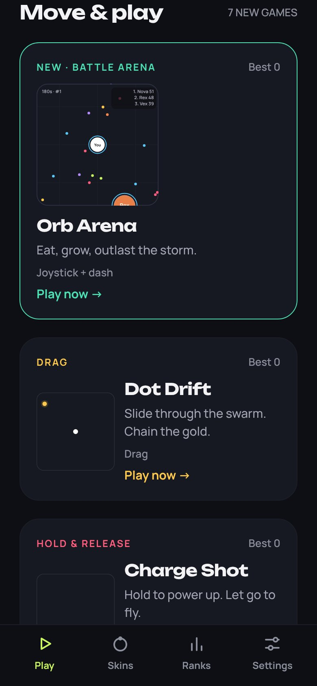
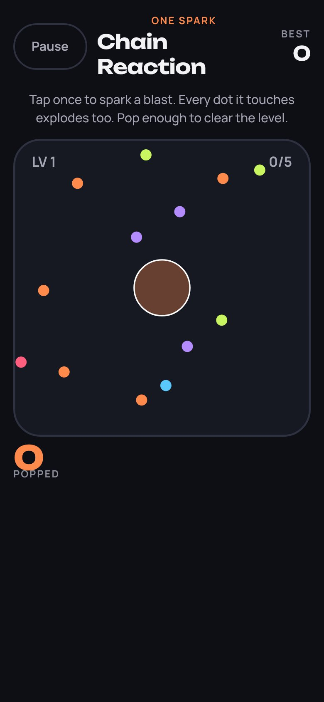
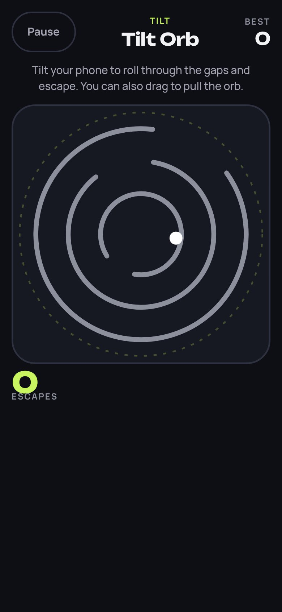

# Move & Play

Seven new games that go beyond a single tap. Each one uses a different gesture, keeps its own personal best, and uses the equipped orb skin, sound, and haptic settings.

| Game           | Gesture                  | How it plays                                                                                                                         | Score                    |
| -------------- | ------------------------ | ------------------------------------------------------------------------------------------------------------------------------------ | ------------------------ |
| Orb Arena      | Floating joystick + Dash | Agar-style survival. Eat pellets and smaller orbs, avoid bigger ones, and stay inside the shrinking storm zone for a 3-minute match. | Peak mass + finish bonus |
| Dot Drift      | Drag                     | Slide through a growing swarm. Chain gold dots within 3 s to build a combo of up to x8.                                              | Points                   |
| Charge Shot    | Hold & release           | Hold to charge, then release to jump to the next pad. A perfect landing scores double. Holding too long burns out the jump.          | Pads                     |
| Swipe Split    | Swipe                    | Fling the dot to the gate of its color. Gates shuffle every 8 sorts, and trick dots change color halfway.                            | Sorts                    |
| Chain Reaction | One tap per level        | Place one spark. Every dot it touches explodes and keeps the chain going. Pop the goal to reach the next level.                      | Popped                   |
| Connect Flow   | Draw                     | Link same-color neighbours against a 45 s clock. Close a loop to clear that whole color. Long chains add time.                       | Dots                     |
| Tilt Orb       | Tilt (drag on web)       | Roll the orb out through gaps in three counter-rotating rings before the timer ends.                                                 | Escapes                  |

## What makes Orb Arena different

- **Dash**: a short burst of speed that costs 12% of your mass. Use it to catch prey or escape.
- **Power-ups** appear every 9 s:
  - **S** (shield) protects you from being eaten for 5 s.
  - **M** (magnet) pulls in nearby pellets for 7 s.
  - **+** (surge) adds 25% mass instantly.
- **Storm zone**: the safe circle starts shrinking after 45 s, and orbs outside it lose mass. Late-game fights are forced instead of camping.
- **Spawn shield**: new orbs get 2.5 s of protection.
- **Live leaderboard and rank** stay on screen. The camera zooms out as you grow.
- **Rival bots** react to threats. They flee bigger orbs, chase smaller ones, graze on pellets, and dash at the right moment.

## Screenshots

These were captured from the Expo web preview at a 390 × 844 phone viewport.

   

   

## Implementation

- `src/game/motion/*.ts`: pure, seeded rules for each game (`create`, `step`, `input`). The same seed and inputs always give the same result.
- `src/app/motion.tsx`: shared screen that handles touch, drag, swipe, the accelerometer, pause/resume, the frame loop, and best scores.
- `src/components/MotionArt.tsx`: SVG rendering for library cards and gameplay.
- `src/state/arcade.ts`: personal bests for all games. Saves from older versions gain the new games without losing scores.
- New dependency: `expo-sensors`, used for Tilt Orb. It is part of Expo Go and needs no config plugin.

## Road to online play

Orb Arena is built so it can go online without rewriting the game:

1. Every orb, human or bot, is driven by the same `ArenaCommand` (`dx`, `dy`, `dash`). A remote player is just another source of commands.
2. `stepArena` is a pure function with a seeded RNG. It can run unchanged on an authoritative server, such as a Node or Bun WebSocket service, at a fixed tick rate.
3. Clients send commands and render server snapshots, with local prediction for their own orb. Bots fill empty seats so matches start instantly.
4. After that, the next candidates are friend rooms with a share code, a weekly leaderboard, and ghost replays for Charge Shot and Chain Reaction. Ghost replays work because these games are deterministic.
