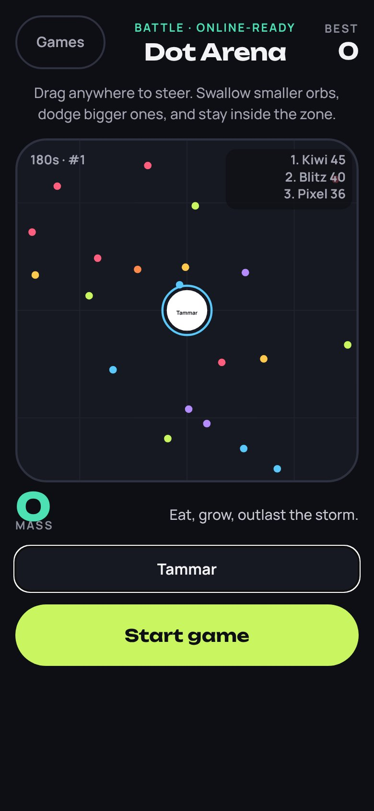
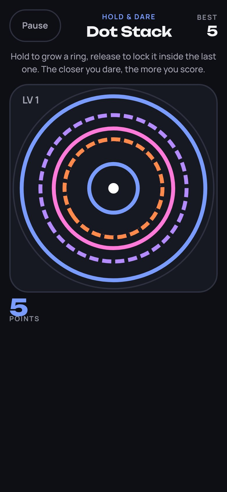
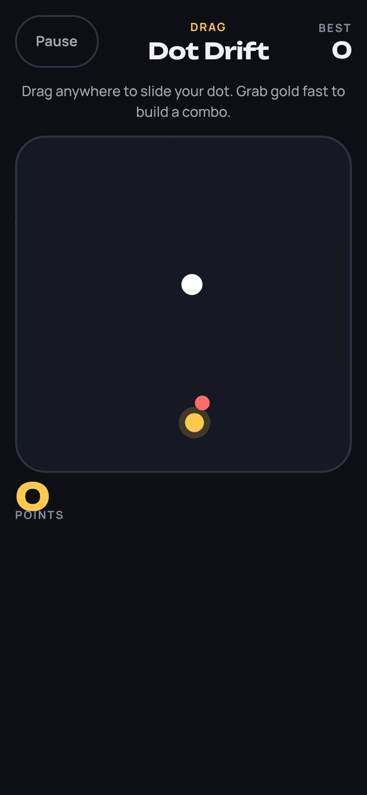
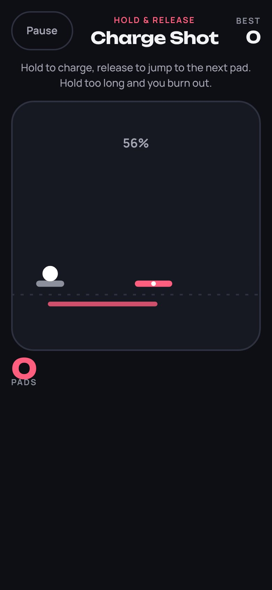
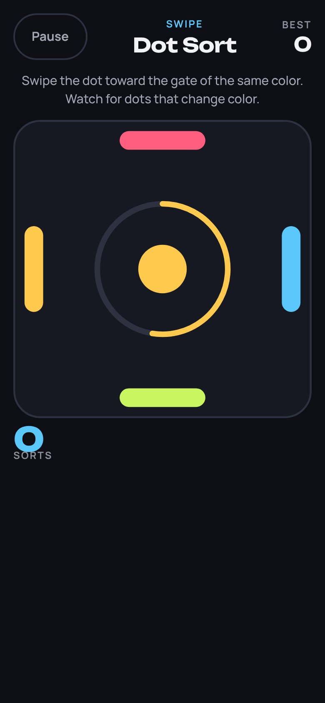
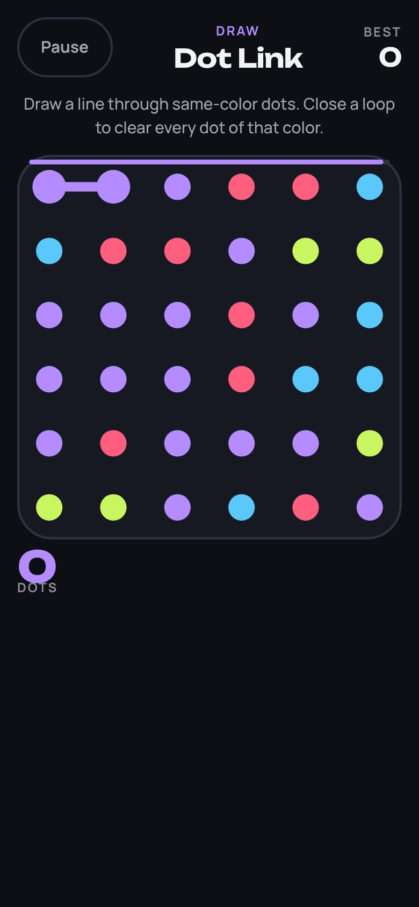
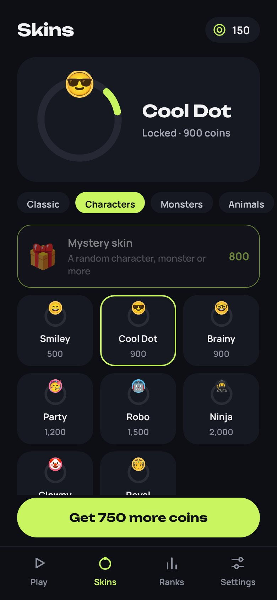
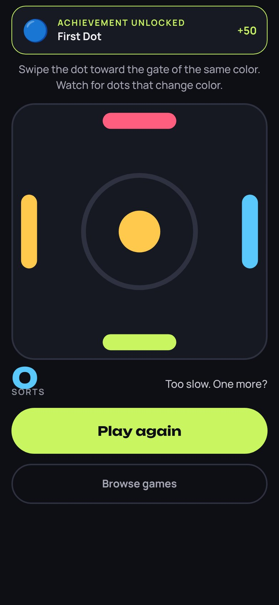

# Move & Play

Seven enabled "Dot" games that go beyond a single tap, alongside the four one-tap circle games (11 games in total). Each Move & Play game uses a different gesture, keeps its own personal best, pays coins at game over, and uses the equipped dot skin, sound, and haptic settings.

| Game      | Gesture                  | How it plays                                                                                                                            | Score                    |
| --------- | ------------------------ | --------------------------------------------------------------------------------------------------------------------------------------- | ------------------------ |
| Dot Arena | Floating joystick + Dash | Agar-style survival. Eat pellets and smaller dots, avoid bigger ones, and stay inside the shrinking storm zone for a 3-minute match.    | Peak mass + finish bonus |
| Dot Paint | Swipe to steer           | Territory battle. Leave your land to draw a trail and come home to claim everything it encloses. Cut a rival's trail to knock them out. | % of the map             |
| Dot Drift | Drag                     | Slide through a growing swarm. Chain gold dots within 3 s to build a combo of up to x8.                                                 | Points                   |
| Dot Jump  | Hold & release           | Charge, then release to land on the next pad. A perfect landing scores double. Holding too long burns out the jump.                     | Pads                     |
| Dot Sort  | Swipe                    | Fling each dot to the gate of its color. Gates shuffle every 8 sorts, and trick dots change color halfway.                              | Sorts                    |
| Dot Link  | Draw                     | Link same-color neighbours against a 45 s clock. Close a loop to clear that whole color. Long chains add time.                          | Dots                     |
| Dot Stack | Hold                     | Grow a ring and lock it just inside the last ring. The closer you dare, the more it scores: +3 for a perfect fit.                       | Points                   |

The one-tap games follow the same naming: Dot Runner (the original), Dot Pulse, Dot Switch, and Dot Lock.

## Dot Arena

- **Dash**: a short burst of speed that costs 12% of your mass.
- **Power-ups**:
  - **S** (shield) protects you from being eaten for 5 s.
  - **M** (magnet) pulls in nearby pellets for 7 s.
  - **+** (surge) adds 25% mass instantly.
- **Storm zone**: the safe circle starts shrinking after 45 s, and dots outside it lose mass.
- **Rival bots** wear fun skins. They flee bigger dots, chase smaller ones, and dash at the right moment.
- **Your name**: you can name your dot before the match. The name appears on the live leaderboard and is saved in Settings under **Your Dot**.

## Skins

The skin store has 94 skins in 8 tabs:

| Tab        | What's in it                                                    |
| ---------- | --------------------------------------------------------------- |
| Classic    | The original solid-color skins                                  |
| Characters | 😎 🤖 🥷 🤴 and more                                            |
| Monsters   | 👾 👻 👹 🐲 and more                                            |
| Animals    | Animal faces                                                    |
| Food       | Snacks and sweets                                               |
| Sports     | Balls and a trophy                                              |
| Space      | Planets, stars and fire                                         |
| Flags      | Every Arab League country plus popular countries worldwide (42) |

A **Mystery skin** (800 coins) unlocks a random fun skin you don't own yet. It never gives a flag, so players pick their own country.

The character or flag shows on your dot in every game drawn with SVG. Dot Runner draws with Skia, so it uses the skin's colors there.

## Achievements

There are 22 visible achievements with coin rewards:

- **Milestones:** plays, distinct games, and play on 7 different days.
- **Battle:** kills, mass, an arena win, territory claimed, and trails cut.
- **Score goals:** one for every game.
- **Other:** skins owned, and sharing a score.

Unlocks show a banner from any screen. The Achievements screen opens from Home, Ranks, or Settings. Every game also pays a few coins at game over, and the **Share score** button invites friends to beat you.

## Screenshots

These were captured from the Expo web preview at a 390 × 844 phone viewport.

   

   

   

   

 

## Implementation

- `src/game/motion/*.ts`: pure, seeded rules for each game (`create`, `step`, `input`).
- `src/app/motion.tsx`: shared screen. It handles touch, multi-touch, swipe, the accelerometer, pause/resume, names, sharing, and rewards.
- `src/components/MotionArt.tsx` and `src/components/SkinDot.tsx`: SVG rendering, including the character and flag skins.
- `src/game/achievements.ts` and `src/state/achievements.ts`: achievement definitions, lifetime counters, and coin rewards.
- Ads are paused with `AdsEnabled = false` in `src/services/config.ts`. Set it to `true` before the production release.

## Road to online play

Dot Arena and Dot Paint are built to go online without rewriting their rules:

1. Every player, human or bot, is driven by the same small input:
   - Arena: a heading plus dash.
   - Paint: a direction.

   A remote player is just another source of that input.

2. The rules are pure functions with a seeded RNG. Dot Paint also advances on a fixed 8 Hz tick. The same code can run on an authoritative server, such as a Node or Bun WebSocket service, and clients send inputs and render snapshots.
3. Bots fill empty seats so matches start instantly. Player names and skins are already part of each player's state.
4. Next steps:
   - Friend rooms with a share code.
   - A weekly leaderboard.
   - Ghost replays for the deterministic games.

Maze, Duel and Chain are disabled by default. See [deferred game ideas](DEFERRED_GAMES.md) for their design and unlock conditions. Their existing sources, tests and saved keys are retained.
